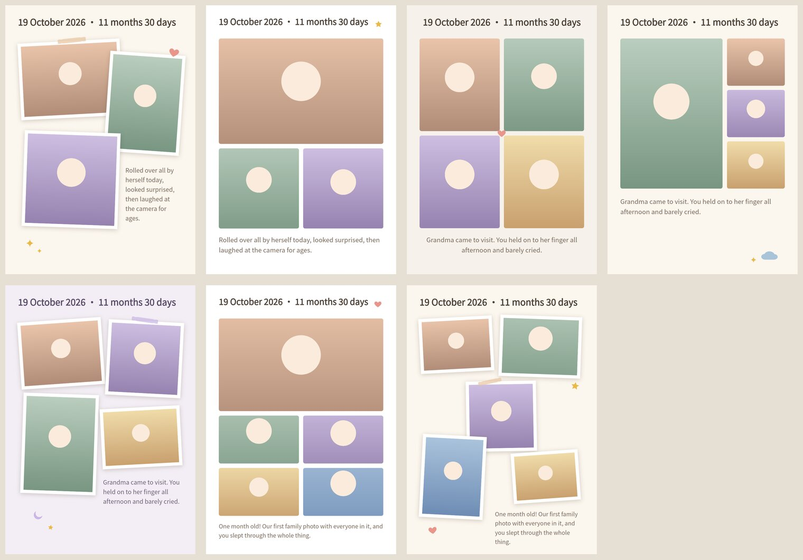

# Little Moments — Phase 1 MVP

AI 辅助宝宝成长手账。Phase 1 不接任何 AI，目标是在真机上验证三件事：**排版好不好看、编辑手感好不好、一页能不能 3 分钟内做完**。



上图由 `tools/template-preview` 用 App 里真实的 `PageContent` 组件离屏渲染生成（占位图 + 示例文字），不是设计稿。

## Phase 1 做了什么

| 流程 | 实现 |
|---|---|
| 宝宝档案 | 首次打开必须建档（小名 + 生日必填；姓名、性别、头像选填）；首页显示月龄和星座，点击可编辑 |
| 导入照片 | 系统相册选择器，最多 10 张；导入时解码降采样，生成 2560px 工作图 + 480px 缩略图，原图不复制 |
| 选 3–5 张 + 一句话 | 恰好选了 3–5 张时自动全选；日期默认取多数照片的 EXIF 拍摄日 |
| 自动排版 | 7 个模板（3/4/5 张各 2–3 个），按照片横竖比例匹配槽位，文字自动缩字号适配 |
| 编辑 | 点选；单指拖动；双指缩放、旋转；改文字（字体/颜色/对齐）；加贴纸；置顶；删除；撤销；Shuffle layout |
| 页面标题 | `19 October 2026 · 3 months 12 days`（日期 + 当天月龄） |
| 保存 | SQLite 自动保存（600ms 防抖），可重新打开编辑 |
| 导出 | 300 dpi A4：PDF（可导入 Goodnotes）或 PNG，通过系统分享面板 |
| 界面语言 | Phase 1 仅英文，文案集中在 `apps/mobile/src/strings.ts` |
| 本地埋点 | 从「New page」到首次导出的耗时，首页底部显示中位数；数据不出设备 |

## 目录结构

```
apps/mobile/            Expo SDK 58 + React Native 0.88（iOS 优先）
  src/app/              路由：首页、新建、编辑器
  src/editor/           手势画布、编辑状态（撤销/保存）、文字和贴纸面板
  src/render/           Skia 渲染（屏幕与导出共用）、文字测量、导出
  src/photos/           导入、降采样、文件路径、孤儿文件清理
  src/db/               SQLite 迁移、仓储、本地埋点
packages/page-schema/   PageDocument 的 Zod schema、版本迁移、几何与编辑纯函数
packages/layout-engine/ 模板数据、确定性排版、贴纸矢量
packages/ai-contracts/  AI 配文的请求/输出/响应契约、输出解析与校验、兜底文案、提示词
apps/api/               AI 配文代理（Hono）：重试与降级、配额、幂等、日志；目前只在本地运行
tools/template-preview/ 在 Node 里用 CanvasKit 渲染所有模板，改模板不用上真机
```

核心约定：**PageDocument 是唯一真相源**。坐标单位是 PDF point（A4 = 595×842），屏幕渲染和 300 dpi 导出只是不同的缩放。排版引擎只产出文档，从不直接画图。

## 在真机上跑起来

前提：Mac + **Xcode 26 或更新**（Expo SDK 58 不支持 Xcode 16；Xcode 26 需要 macOS 15.6+）、Node 22.13+ 或 24（Expo 不支持奇数版本，仓库根目录有 `.nvmrc`，用 nvm 的话执行 `nvm use`）、pnpm 10、iPhone/iPad 已开启开发者模式。免费 Apple ID 的 Personal Team 就能装到自己的设备上（证书 7 天有效）。

```bash
pnpm install
cd apps/mobile
npx expo-doctor            # 我这边有一项检查需要联网没跑成，请你本地跑一次
npx expo run:ios --device  # 首次会 prebuild + pod install + 编译 dev client，比较久
```

签名报错时：`npx expo prebuild -p ios` 后打开 `ios/*.xcworkspace`，在 Signing & Capabilities 里选你的 Team；有冲突就改 `app.json` 里的 `ios.bundleIdentifier`。`ios/` 是生成产物，不要手改、不要提交。

**测性能和内存请用 Release 构建**，Debug 构建的 JS 很慢，会误导结论：

```bash
npx expo run:ios --device --configuration Release
```

## 在安卓平板上测试

不需要 Android Studio，用 EAS 云构建出一个 APK，直接装到平板上：

```bash
pnpm install
cd apps/mobile
npx eas-cli@latest login                                  # 免费 Expo 账号
npx eas-cli@latest build -p android --profile preview    # 首次会问是否创建 EAS 项目，选 Yes
```

构建完成后终端会给出一个链接和二维码，用平板打开下载 APK 安装（需要允许“安装未知来源应用”）。`preview` 是独立的 Release 包，JS 已经打包进去，不需要连电脑。

- 第一次运行 `eas build` 会把 `extra.eas.projectId` 写进 `app.json`，记得提交。
- 每改一次代码都要重新构建。免费额度的队列可能要等一阵。
- 本地构建也可以：装 Android Studio，平板开 USB 调试，然后运行 `npx expo run:android --device --variant release`。

注意：目标用户在 iPad 上，安卓平板的结果只能验证流程、排版和手势逻辑，**性能和内存数据不能代表 iPad**。安卓上的字体走系统默认字体，没有针对性调过。

## 本地运行 AI 配文服务

```bash
cd apps/api
cp .env.example .env        # 填入 ANTHROPIC_API_KEY；.env 已被 gitignore
pnpm smoke                  # 真实调用 3 次：验证 API 接受我们的 JSON Schema，并看延迟
pnpm dev                    # http://localhost:8787 ，模拟器可直接访问
```

```bash
curl -s -X POST localhost:8787/v1/captions \
  -H 'content-type: application/json' -H 'x-device-id: 0b6f2a7c-6a39-4b7e-9c55-3f1d2e8a9b10' \
  -d '{"requestId":"7d3c8a0e-2f4b-4c1d-9e8f-000000000001","input":{"nickname":"Mia","ageText":"3 months 12 days","note":"rolled over today","photoCount":3,"pronoun":"she"}}'
```

**上线前必须先做身份校验**（App Attest 或用户登录）。`X-Device-Id` 由 App 自己生成，可以伪造，只用于限流。

## 真机测试清单

这一版存在的意义就是拿到下面这些数据。

**1. 内存（最大的风险）**
- [ ] 用 Xcode → Product → Profile → Allocations / VM Tracker，导入 10 张 48MP 原图，记录峰值
- [ ] 反复进出编辑页 10 次，内存是否回落（检查 SkImage 是否释放）
- [ ] 连续导出 3 次 PDF，看是否被系统杀掉
- [ ] 如果吃紧：先调小 `src/photos/import.ts` 的 `WORK_EDGE`（2560 → 2048）

**2. 编辑手感**
- [ ] 拖动、双指缩放和旋转是否跟手，在 iPad 和 iPhone 上各测一次
- [ ] 刚松手时，图层有没有闪回原位一帧（`EditorCanvas.tsx` 里提交与重置的时序）
- [ ] 两个图层重叠时，点选和拖动是否符合预期

**3. 导出**
- [ ] 导出后屏幕底部会显示 `渲染 ms / 编码 ms / 文件大小`，记下 PDF 和 PNG 的数字
- [ ] PDF 导入 Goodnotes：清晰度、能否在上面手写、文件大小
- [ ] 中文、英文、emoji 在导出图里是否正常（emoji 在 Skia Paragraph 里可能缺字形）

**4. 导入**
- [ ] HEIC 照片能否导入（选择器设置了 `compatible`，应返回 JPEG）
- [ ] 日期是否正确取自拍摄时间；如果 EXIF 拿不到，会退回今天
- [ ] 「有限照片访问」权限下是否正常

**5. 3 分钟目标**
- [ ] 做 5 页真实的手账后，看首页底部的中位耗时

## 已知限制（有意没做）

- 文字是系统字体（PingFang / Georgia / Chalkboard SE），没打包字体，Android 只能保证能显示。
- PDF 是一张 300 dpi JPEG：文字不可选中、不可搜索。矢量文字需要嵌入字体并做 CJK 子集化。
- 照片在相框内不能平移裁剪（裁剪框默认居中），这是下一个最该加的编辑能力。
- 没有手写和 Apple Pencil，按计划交给 Goodnotes。
- 没有备份和同步：卸载 App 会丢数据。原图仍在系统相册里，但手账页面会丢失。
- 「换个排版」会覆盖手动调整（可以撤销）。
- 本地去重和模糊检测（Vision 原生模块）留到下一步。

## 开发

```bash
pnpm test                 # schema / 排版引擎 / 月龄星座 / 表单校验的单测
pnpm typecheck
cd apps/mobile && npx expo lint

# 改模板后在 Node 里重新渲染预览（需要一个含中文字形的 .otf/.ttf）
cp /path/to/NotoSansSC.otf tools/template-preview/
pnpm --filter @lm/template-preview preview   # 输出到 tools/template-preview/out/
```

改 `PageDocument` 结构时，按 `packages/page-schema/src/migrations.ts` 顶部的说明加迁移：存下来的页面要能保存很多年。
